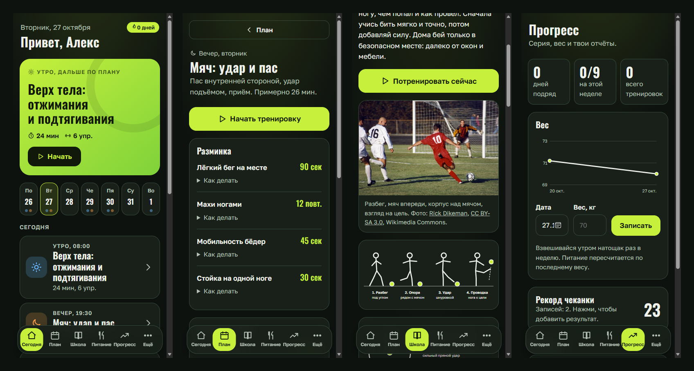

# QuorFootball

Тренировки футболиста дома: план недели под твоё оборудование, питание и вода, таймер, школа (чеканка, удар, пас, отжимания, подтягивания) и отчёты с фото. Работает как **приложение для Android без интернета и без аккаунта**, а также как сайт на своём сервере.



## Скачать приложение

APK лежит в [релизах](../../releases/latest) (файл `QuorFootball-1.0.0.apk`). Скачай на телефон, открой, разреши установку из этого источника. Приложение работает без интернета, все данные хранятся только на телефоне. Нужен Android 5.1 или новее.

## Что умеет

- **План под оборудование.** Турник, брусья, гантели (с весом), резинки, скакалка, стул, конусы, мяч, стена, двор. Нет турника, будет тяга с гантелью или резинкой. Нет ничего, всё равно полная программа.
- **Три уровня.** Новичок (4 дня), средний (5), опытный (6). Отжимания от стены до алмазных, подтягивания с негативных, брусья, пресс, ноги. Нагрузка растёт по четырёхнедельному циклу, четвёртая неделя разгрузочная.
- **Школа мяча.** 58 упражнений с мячом в семи разделах: контроль, дриблинг, финты, точность, чеканка, футзал, игра под давлением. Идеи из европейских школ: Кёрвер (Нидерланды), футзал, испанское рондо, подход Аякса. У каждого упражнения схема (вид сверху), шаги, ошибки и подсказка, сколько нужно места. Описания написаны с нуля.
- **Очень тесно, 1×1 м.** Одна галка в профиле оставляет только упражнения на месте. Мячевые тренировки каждую неделю берут другие упражнения из слотов, чтобы не надоедало.
- **Для города.** Нет стены и поля, не страшно: точность паса (пас в «ворота», под стул), первое касание, ведение в квадрате 2×2 м и ловкость тренируются дома. «Тихий режим» убирает прыжки и спринты для квартиры.
- **План Б.** Дождь или нет места: у тренировок с мячом и скоростью есть кнопка «Сделать дома», она собирает такую же тренировку для комнаты. В зачёт идёт как обычная.
- **План двигается.** Пропустил тренировку, она переедет на ближайший день без тренировок (выходной «съедается»), старше трёх дней не догоняем.
- **Напоминания.** Время утром и вечером, уведомление приходит, только если тренировка ещё не сделана.
- **Школа.** 11 уроков со ступенями, схемами, фото, ошибками и видео: чеканка с нуля, удар подъёмом, пас, приём, ведение, слабая нога, футбол в городе, отжимания, подтягивания, пресс, безопасность дома.
- **Тренировка по шагам.** Таймер, отдых, звук и вибрация, подсказка «как делать» у каждого упражнения. Разминка по мотивам профилактических программ вроде FIFA 11+.
- **Питание и вода.** Калории, белки/жиры/углеводы, приёмы пищи, список покупок. Несовершеннолетним дефицит калорий не ставится.
- **Прогресс.** Серия дней, вес, рекорд чеканки, отчёты с фото и видео.
- **Своя тренировка.** Собираешь из базы около 140 упражнений.

## Приватность

Аккаунта нет, аналитики нет, приложение ничего никуда не отправляет. Всё лежит на телефоне (SQLite внутри приложения), удалить можно кнопкой «Удалить все мои данные» или удалив приложение. Видео в школе грузится с YouTube только после нажатия на него. Подробности на странице `public/privacy.html`.

Расчёты питания и нагрузки примерные и не заменяют врача или тренера.

## Как это устроено

Один код, два режима:

| Режим | Где данные | Как работает |
| --- | --- | --- |
| Приложение Android | на телефоне (SQLite в WebAssembly, IndexedDB) | те же серверные маршруты запускаются прямо внутри приложения, интернет не нужен |
| Сайт | на сервере (Node, `node:sqlite`) | Express, вход без пароля по случайному ключу в куке |

Фронт без сборки (ES-модули), приложение упаковано через [Capacitor](https://capacitorjs.com). Папка `local/` содержит замену серверных кусков для приложения (мини-роутер, `sql.js`, хранилище файлов, локальные уведомления), сами маршруты и логика плана общие.

## Запуск сайта

Нужен Node 22.13 или новее.

```
npm install
npm start
```

Открой http://127.0.0.1:3100.

### Docker

```
docker compose up -d --build
```

Порт открыт только на `127.0.0.1`: поставь перед ним nginx или Caddy с HTTPS. База и загрузки лежат в томе `football-data`. Настройки смотри в `.env.example` (`PORT`, `HOST`, `COOKIE_SECURE`, `TRUST_PROXY`, `DB_PATH`, `UPLOADS_DIR`, ключи VAPID для уведомлений).

Уведомления на сайте идут через Web Push: нужен HTTPS (на `localhost` работает и так), ключи VAPID создаются при первом запуске рядом с базой (`vapid.json`, не коммить), на iPhone нужно добавить сайт на экран «Домой».

## Сборка приложения для Android

Нужны Node 22+, JDK 17 и Android SDK (платформа 34 и build-tools 35.0.0, Gradle докачает недостающее сам).

```
npm install
npm run build:app          # собирает папку www: сайт + автономный слой
npx cap sync android
cd android
./gradlew assembleDebug    # app/build/outputs/apk/debug/app-debug.apk
```

Для подписанного релиза создай ключ (`keytool -genkeypair ...`), положи его **вне репозитория** и укажи путь к файлу настроек в переменной `QF_KEYSTORE_PROPS` (поля `storeFile`, `storePassword`, `keyAlias`, `keyPassword`), потом `./gradlew assembleRelease`. Ключ и пароли нельзя коммитить, а потеряв ключ, нельзя обновлять приложение поверх установленного. Файл `android/local.properties` с путём к SDK создаётся у тебя локально (`sdk.dir=...`) и в git не попадает.

## Проверки

```
npm run check
```

Запускает тесты: перенос пропущенных тренировок, логику напоминаний, API приложения (внутри Node) и API сайта на отдельной базе.

## Как расширять

| Что | Где |
| --- | --- |
| Упражнения, описания «как делать», что нужно из оборудования | `data/library.js` |
| Тренировки и расписание по уровням | `data/program.js` |
| Уроки школы | `data/lessons.js` |
| Калории, вода, советы, покупки | `data/plan.js` |
| Схемы уроков | `public/img/lessons/*.svg` |
| Схемы упражнений (рисуются кодом) | `public/js/diagrams.js` |
| Новые упражнения с мячом по школам | `data/drills.js` |
| Фото с подписью автора и лицензии | `public/img/photos/`, `public/js/photos.js` |

Видео в урок: добавь `{ yt: 'ID', title, channel }` в `videos`, предварительно проверив, что ролик открывается и разрешено встраивание. Чужие фото и видео без разрешения автора в репозиторий не добавляй.

Шрифты Oswald и Golos Text лежат в `public/fonts` (лицензия SIL OFL), к сторонним серверам приложение не обращается.

Про безопасность и обновление зависимостей: `SECURITY.md`. `npm audit` может ругаться на `tar` внутри `@capacitor/cli`: это инструмент сборки на твоём компьютере, он не попадает ни в приложение, ни в сервер.

## Лицензия

Код под MIT, см. `LICENSE`. Фото остаются под своими лицензиями (таблица ниже).

## Фото и лицензии

Фото взяты с Wikimedia Commons по свободным лицензиям, под каждым снимком в приложении указаны автор и лицензия. Файлы уменьшены до 960 px по ширине.

| Файл | Автор | Лицензия | Источник |
|---|---|---|---|
| `public/img/photos/kick.jpg` | Rick Dikeman | [CC BY-SA 3.0](https://creativecommons.org/licenses/by-sa/3.0/) | [Commons](https://commons.wikimedia.org/wiki/File:Football_in_Bloomington,_Indiana,_1995.jpg) |
| `public/img/photos/pullup.jpg` | PTPioneer | [CC BY 2.0](https://creativecommons.org/licenses/by/2.0/) | [Commons](https://commons.wikimedia.org/wiki/File:Pull-ups_exercise_from_back.jpg) |
| `public/img/photos/plank.jpg` | Jaykayfit | [CC BY-SA 3.0](https://creativecommons.org/licenses/by-sa/3.0/) | [Commons](https://commons.wikimedia.org/wiki/File:Plank.jpg) |
| `public/img/photos/dribble.jpg` | U.S. Army, Sgt. Nicodemus Taylor | общественное достояние | [Commons](https://commons.wikimedia.org/wiki/File:Soldiers_attend_soccer_clinic_held_by_professional_players_at_Pabrad%C4%97_Training_Area_(9796131).jpg) |
| `public/img/photos/pushup.jpg` | U.S. Army, Spc. Esmeralda Cervantes | общественное достояние | [Commons](https://commons.wikimedia.org/wiki/File:60_Hand-Release_Push-ups_(6244934).jpg) |
| `public/img/photos/freestyle.jpg` | Mostafameraji | [CC BY-SA 4.0](https://creativecommons.org/licenses/by-sa/4.0/) | [Commons](https://commons.wikimedia.org/wiki/File:Football_freestyle_Iran-Mohammad_Akbari_%D8%AD%D8%B1%DA%A9%D8%A7%D8%AA_%D8%A7%D9%86%D9%81%D8%B1%D8%A7%D8%AF%DB%8C_%D9%81%D9%88%D8%AA%D8%A8%D8%A7%D9%84_%D9%86%D9%85%D8%A7%DB%8C%D8%B4%DB%8C._%D8%A7%DB%8C%D8%B1%D8%A7%D9%86._%D9%85%D8%AD%D9%85%D8%AF_%D8%A7%DA%A9%D8%A8%D8%B1%DB%8C_24.jpg) |

---

## English

QuorFootball is a home football training app: a weekly plan built around the equipment you own (and a no-wall, no-yard city mode with a quiet option for apartments), nutrition and water targets, a workout timer, lessons (juggling, shooting, passing, push-ups, pull-ups) and photo workout reports. The interface is in Russian.

- **Android app**: download the APK from [Releases](../../releases/latest). It is fully offline, has no account and no analytics; all data stays on the phone.
- **Self-hosted site**: Node 22.13+, `npm install && npm start`, open http://127.0.0.1:3100. Docker: `docker compose up -d --build`.
- **Build the APK yourself**: `npm run build:app && npx cap sync android && cd android && ./gradlew assembleDebug` (JDK 17, Android SDK 34). Release signing keys live outside the repo and are passed via `QF_KEYSTORE_PROPS`.
- **Tests**: `npm run check`.

Code is MIT; photos are from Wikimedia Commons and keep their own licenses (see the table above).
